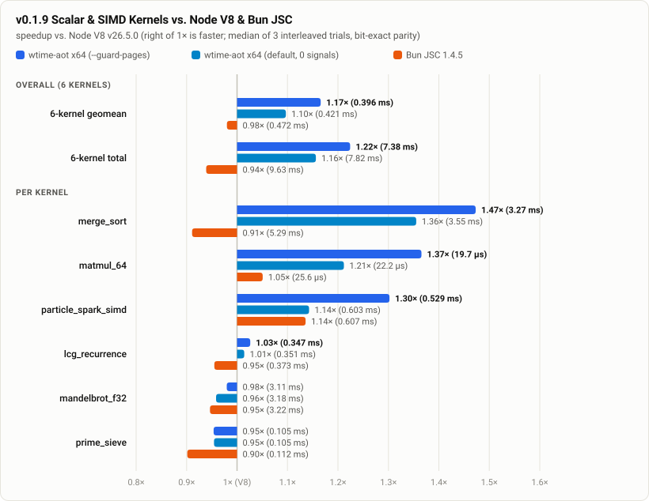

# wtime

**A safe-Rust, zero-dependency WebAssembly Core 3.0 runtime — with an optional ahead-of-time compiler for native speed.**

`#![forbid(unsafe_code)]` · **0** external production deps · **Wasm Core 3.0 + Phase 3–5** · **No runtime JIT**

---

## Two Layers

Most WebAssembly runtimes force a choice between a large `unsafe` JIT and an incomplete interpreter. `wtime` separates them:

- **Core runtime (`crates/*`)** — 100% safe Rust, zero third-party deps, full Core 3.0 + Phase 3–5 support (GC, exceptions, threads, memory64, SIMD, continuations), fuel metering, and cancellation.
- **Optional AOT compiler (`tools/wtime-aot`)** — compiles validated `.wasm` ahead of time to native code with pure-Rust backends (`x64`, `aarch64`, zero LLVM) or `c` / `rust` backends.


---

## Benchmarks

Every chart below verifies **bit-exact output parity** across all engines. Full tables and reproduction commands live in **[docs/benchmarks.md](docs/benchmarks.md)**.

### At a Glance (vs. Wasmtime)


### Scalar & SIMD Kernels (vs. Node V8 & Bun JSC)

In `v0.1.9`, pure-Rust `--backend x64` averages **1.17× faster than V8** and **1.19× faster than Bun JSC** with `--guard-pages` — and **1.10× / 1.12× faster** with default software bounds checks.



### Wasm Kernels (vs. Wasmtime & V8)

Pure-Rust `--backend x64` beats Wasmtime on all 6 kernels (**6.69×** geomean) and V8 (**5.18×** geomean).


### Real Programs & Self-Hosting Compiler

Across 18 real workloads, `--backend rust` runs **1.3–13× faster than Wasmtime** and **2.8–148× faster than V8**.


### Compile Time, Incremental Rebuilds, & Warm Load

On a 4,523-function (`5.91 MiB`) SIMD app, pure-Rust `--backend x64` compiles **2.49× faster cold** (`151 ms`), rebuilds 1-function edits **15.9× faster** (`23 ms`), and loads **54× faster** (`0.034 ms`) than Wasmtime.


---

## Choosing a Mode


| Mode | Best for | External tools | Highlights |
| --- | --- | --- | --- |
| **`wtime-runtime`** *(core)* | Untrusted plugins, full spec coverage | None | `#![forbid(unsafe_code)]`, fuel, cancellation, optional `register-executor` |
| **`wtime-aot --backend x64`** / **`aarch64`** | Fast edit-compile-run & zero-LLVM AOT | None | `.so` & static binaries, incremental rebuilds, optional `--guard-pages` |
| **`wtime-aot --backend c`** | C toolchain integration & CET hardening | Clang + `ld.lld` | Sharded `-O2` `.so` builds with shadow-stack support |
| **`wtime-aot --backend rust`** | Peak LLVM `-O3` standalone binaries | `rustc` | `#![forbid(unsafe_code)]` guest codegen, sandboxed executables |

---

## Quick Start

### Safe-Rust interpreter

```sh
cargo run --locked -p wtime-cli -- check module.wasm
cargo run --locked -p wtime-cli -- --fuel 100000 run module.wasm add i32:20 i32:22
```

For Rust embedding, see **[docs/embedding.md](docs/embedding.md)** and **[examples/](examples/README.md)**.

### Ahead-of-time compiler (`wtime-aot`)

```sh
cargo build --locked --release --manifest-path tools/wtime-aot/Cargo.toml

# Pure-Rust x86-64 shared library (no LLVM/Clang)
tools/wtime-aot/target/release/wtime-aot build module.wasm --cache /tmp/aot --blot-cdylib --backend x64

# Standalone sandboxed binary via safe-Rust codegen
tools/wtime-aot/target/release/wtime-aot build module.wasm --cache /tmp/aot
```

---

## Documentation

- **Performance** — [Benchmarks & methodology](docs/benchmarks.md) · [Goose & interpreter benchmarks](tools/wtime-goose/README.md)
- **Using `wtime`** — [Embedding guide](docs/embedding.md) · [Native examples](examples/README.md) · [CLI, crates, & testing](docs/development.md)
- **AOT Compiler** — [`wtime-aot` guide & threat model](tools/wtime-aot/README.md) · [x64 ABI & safety contract](docs/wtime-aot/x64-abi.md)
- **Architecture & Release** — [Spec scope](docs/architecture/scope.md) · [API contract](docs/architecture/api.md) · [Security model](docs/architecture/security-model.md) · [Release readiness (`v0.1.9`)](docs/release-readiness.md) · [Changelog](CHANGELOG.md) · [Security](SECURITY.md)
