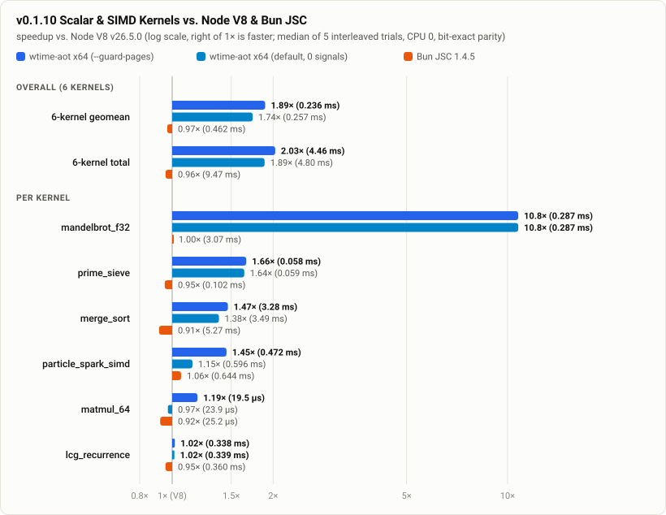

# Benchmarks & Methodology

All numbers in this document and the root [README](../README.md) come from real runs with **byte-exact output parity** verified across every compared engine.

---

## 1. Test Environment (`wtime-aot` vs. Wasmtime & V8)

Recorded in [`tools/wtime-aot/charts/results.json`](../tools/wtime-aot/charts/results.json) (captured `2026-11-27` on `v0.1.10`):

| Component | Version / Spec |
| --- | --- |
| CPU | AMD Ryzen 7 7800X3D (8 cores / 16 threads, AVX-512) |
| OS | Linux `7.3.5` (`x86_64-unknown-linux-gnu`) |
| Rust toolchain | `rustc 1.99.0` |
| C compiler & linker | `clang 23.1.5` + `ld.lld` |
| Wasmtime | `49.0.3` (Cranelift `OptLevel::Speed`, `parallel_compilation(true)`) |
| V8 | Node.js `v26.13.1` (Liftoff + TurboFan, warmed before timing) |

---

## 2. Execution Time — Self-Contained Wasm Kernels

7 paired rounds per kernel, alternating engine order every round, pinned to CPU 0 (`taskset -c 0`). Lower is better.


| Kernel | `wtime-aot x64` | `wtime-aot c (-O2)` | `wtime-aot rust (-O3)` | Wasmtime `49.0.3` | V8 (`Node v26.13`) | Parity hash |
| --- | ---: | ---: | ---: | ---: | ---: | --- |
| `graph_bfs` | **0.016 µs** *(414× vs WT)* | 6.61 µs | **1.12 µs** *(5.91× vs WT)* | 6.62 µs | 2.60 µs | `04aa4f2359a193ae` |
| `parser_hash` | **3.31 µs** *(1.00× vs WT)* | 3.52 µs | 3.39 µs *(0.98× vs WT)* | **3.31 µs** | 3.42 µs | `0501be7dc7425cf0` |
| `image_filter` | **0.278 µs** *(17.3× vs WT)* | 3.91 µs | 3.65 µs *(1.32× vs WT)* | 4.82 µs | 4.67 µs | `79b786ce0d4a3fc0` |
| `ecs_kernel` | **5.05 µs** *(3.86× vs WT)* | 10.22 µs | **6.21 µs** *(3.14× vs WT)* | 19.50 µs | 12.71 µs | `9f9dd941bb465bbb` |
| `matmul_f64` | **35.52 µs** *(3.83× vs WT)* | 127.78 µs | **75.75 µs** *(1.80× vs WT)* | 136.12 µs | 117.00 µs | `d439b84aa68434e6` |
| `heapsort_i32` | **24.82 µs** *(1.29× vs WT; 1.25× vs V8)* | 53.31 µs | 50.42 µs *(0.63× vs WT)* | 31.97 µs | 31.12 µs | `2fa61a2b53989045` |

Across all 6 kernels, pure-Rust `--backend x64` sweeps **all 6 kernels** over Wasmtime `49.0.3` (**7.18×** geomean), V8 (**5.55×** geomean), Clang `-O2` (**6.77×** geomean), and `--backend rust (-O3)` (**4.14×** geomean) — using default software bounds checks with zero process-wide signal handlers. Key passes include sparse equality-filtered loop narrowing (`graph_bfs`), AVX2 16-byte 3-tap blur + boundary-clamp peeling (`image_filter`), hoisted Granlund–Montgomery magic division + SLP (`ecs_kernel`), 2×-unrolled AVX2/AVX-512 `F64AxpyLoop` auto-vectorization (`matmul_f64`), and algebraic binary-heap `sift_down` reassociation + hole-sift store sinking (`heapsort_i32`: **24.82 µs**, **1.29×** faster than Wasmtime, **1.25×** faster than V8, and **2.03×** faster than Rust `-O3`).

---

## 2b. `v0.1.10` Scalar & SIMD Kernels vs. Node V8 & Bun JSC

Interleaved 5-trial median runs pinned to CPU 0 (`rustc 1.99.0` `wasm32-unknown-unknown -C opt-level=3 -C target-feature=+simd128`, Node `v26.5.0`, Bun `1.4.5`). Lower is better.



| Kernel | `wtime-aot x64` default | `wtime-aot x64 --guard-pages` | Node V8 `v26.5.0` | Bun JSC `1.4.5` | Parity hash |
| --- | ---: | ---: | ---: | ---: | --- |
| `lcg_recurrence` | 0.3388 ms | **0.3380 ms** *(1.02× vs V8)* | 0.3440 ms | 0.3603 ms | `4c150ccc5d85ec72` |
| `matmul_64` | 0.0239 ms | **0.0195 ms** *(1.19× vs V8)* | 0.0232 ms | 0.0252 ms | `e6aa02b1f39648b0` |
| `prime_sieve` | **0.0592 ms** | **0.0584 ms** *(1.66× vs V8)* | 0.0971 ms | 0.1022 ms | `e510569102d0c5a4` |
| `mandelbrot_f32` | **0.2867 ms** | **0.2868 ms** *(10.76× vs V8)* | 3.0856 ms | 3.0704 ms | `a833287a3e3d61ab` |
| `particle_spark_simd` | 0.5955 ms | **0.4716 ms** *(1.45× vs V8)* | 0.6847 ms | 0.6439 ms | `07362991fa78bb70` |
| `merge_sort` | 3.4929 ms | **3.2846 ms** *(1.47× vs V8)* | 4.8142 ms | 5.2690 ms | `b8f8c7ab067e1816` |
| **6-kernel total** | **4.7970 ms** | **4.4589 ms** *(2.03× vs V8)* | 9.0488 ms | 9.4710 ms | — |
| **6-kernel geomean** | **0.2567 ms** | **0.2356 ms** *(1.89× vs V8)* | 0.4461 ms | 0.4615 ms | — |

On `mandelbrot_f32`, pure nested-loop outer SIMD vectorization (`Op::SimdOuterLoop`) scales cleanly across every x86-64 ISA tier while beating both V8 (`3.0856 ms`) and Bun JSC (`3.0704 ms`): **0.8845 ms** (`3.47×`) on `x86-64-v2` (SSE2 4-wide), **0.5293 ms** (`5.80×`) on `x86-64-v3` (AVX2 8-wide), and **0.2867 ms** (`10.76×`) on `x86-64-v4` (AVX-512 16-wide).

---

## 3. Compilation, Incremental Rebuilds, & Warm Load

Measured across 5 fresh-cache rounds (cold & 1-function edit) and 7 warm rounds on a real **6.39 MiB, 4,572-function** WebAssembly application (`--jobs 0`, 16 threads) plus the 6 self-contained kernels.

- **Cold compile boundary** (identical across engines): fresh process reads `.wasm` from disk, compiles multi-core, and writes the compiled artifact (`.so` + `.sha256` for `wtime-aot`; serialized `.cwasm` for Wasmtime).
- **1-function edit boundary**: inserts a `nop` into one function body with a warmed cache (`x64-inc` parallel function cache + compact `.delta` incremental sidecars + 64 KiB Merkle chunking + companion `.vidx` Merkle-verified incremental validation index + overlapped `.bin`/`.delta` preload + filtered inlining strata + zero-alloc SCCs + parallel `.text` merge & relocation patching for `x64`; sharded `.c` recompile for `c`; full recompile for Wasmtime).
- **Warm artifact load boundary**: fresh process maps and validates the compiled artifact (`dlopen(..., RTLD_NOW)` + `dlsym` for `.so`; `Module::deserialize_file` for `.cwasm`).


| Metric (`4,572`-fn, `6.39 MiB` Wasm app) | `wtime-aot x64` | `wtime-aot c (-O2)` | Wasmtime `49.0.3` |
| --- | ---: | ---: | ---: |
| Cold compile (empty cache, 16T) | **178.5 ms** *(2.44× vs WT)* | 16.4 s | 434.7 ms |
| Incremental 1-fn edit (warm cache, 16T) | **24.4 ms** *(18.0× vs WT)* | 928.8 ms | 438.9 ms |
| Warm fresh-process load (`.so` vs `.cwasm`) | **0.033 ms** *(60× vs WT)* | 0.168 ms | 1.973 ms |
| Warm CLI `wtime-aot build --cache` hit | **10.25 ms** | 300.9 ms | — |
| Compiled artifact size | **8.80 MiB** (`.so`) | 11.74 MiB (`.so`) | 10.11 MiB (`.cwasm`) |

On tiny 0.3–0.5 KiB kernels, `wtime-aot x64` cold CLI builds take **1.56–1.85 ms** (comparable to Wasmtime's **1.49–1.80 ms**; warm cache hits **0.83–0.95 ms**), compared to **403–479 ms** for Clang `-O2` and **1.80–1.86 s** for Rust `-O3`.

On `--backend aarch64` (2,000-function module, 16T), multi-core cold builds complete in **12.26 ms**, 1-function incremental edits (`a64-inc` + `.vidx`) drop to **7.94 ms** with **100% byte-for-byte ELF parity** against cold builds, and warm CLI cache hits complete in **2.05 ms**.

---

## 4. Standalone Programs & Self-Hosting Compiler (`--backend rust`)

18 real programs — 10 standalone algorithms (`sorting`, `life`, `sudoku`, `sieve`, `maze`, `vm`, etc.) plus 8 self-hosting Goose compiler workloads across both `memory32` and `memory64` — measured on single-CPU paired rounds (`AMD Ryzen 7 3800X`, Linux `7.3.4`, Wasmtime `50.0.1`, Deno `2.9.8` / V8 `15.0`). Full per-program tables and methodology live in [`tools/wtime-goose/README.md`](../tools/wtime-goose/README.md#ahead-of-time-wtime-aot).

- **Execution (`_start`)**: `wtime-aot --backend rust` beats Wasmtime by **1.3–13×** and V8 by **2.8–148×** across all non-trivial workloads.
- **Whole process (start, load, run, exit)**: beats **cached Wasmtime** by **1.01–2.94×** and **V8** by **3.2–94×**.


---

## 5. Core Interpreter (`wtime-runtime`) Performance Profile

The core interpreter (`crates/*`) intentionally excludes JIT compilation and native stack execution to keep `#![forbid(unsafe_code)]`, zero dependencies, deterministic source-level fuel, and full Core 3.0 + Phase 3–5 semantics:

- **Fast cold startup & small inputs**: on short programs and uncached cold loads, `wtime-runtime` finishes in **0.06–0.15×** of V8's process time and avoids multi-second uncached JIT compilation (preparing a `7.3 MiB` compiler module in `0.20–0.29 s` vs. `5.4–7.5 s` for uncached Wasmtime).
- **Compute-heavy steady state**: long-running CPU loops run roughly **10–120×** slower than native JIT/AOT code in the default decoded interpreter. Enabling the opt-in experimental `--features register-executor` lazy register tier (12-byte packed `RegOp`, variable 1-or-2 `u64` slots for full native 236-opcode `simd` + 20-opcode `relaxed_simd` parity, contiguous dense-memory fast path for active memories `<= 16 MiB` with fallible promotion and clean sparse demotion past `16 MiB`, zero-`Arc` intra-instance calls, O(1)-frame `tail_call` `return_call`/`return_call_indirect`, `wide-arithmetic` `0xfc13..=0xfc16`, fused integer/float/branch superinstructions, and native `call_indirect`/`memory.copy`/`memory.fill`/`memory.grow` lowering) speeds up the 4 kernel workloads by **4.09–4.67×** (`ecs_f64` `4.67×`, `parser_hash` `4.23×`, `image_filter` `4.14×`, `graph_bfs` `4.09×`) and 8-page (`512 KiB`) multi-page scatter/gather by **3.32×** (`137.7 µs` vs. `457.0 µs`) while preserving bit-exact Wasm semantics, source-level fuel, and cancellation — and lazily admitting **99.8%** (`4,443 / 4,454`) of functions in the 5.72 MiB SIMD app in `27.9 ms`. When native throughput matters, compile hot modules ahead of time with `tools/wtime-aot`.

See [`tools/wtime-goose/README.md`](../tools/wtime-goose/README.md#results-2026-11-20) for the full interpreter benchmark tables.

---

## 6. Reproducing Locally

Anyone with Rust `1.99.0`, Clang, and Node.js can reproduce the self-contained kernel benchmarks and charts:

```sh
cargo build --locked --release --manifest-path tools/wtime-aot/Cargo.toml
python3 -B tools/wtime-aot/bench.py --kernels-only --cold-rounds 5 -o target/aot-kernels.json
python3 -B tools/wtime-aot/chart.py target/aot-kernels.json -o target/aot-charts
```

Optional flags:
- `--wasmtime-driver PATH`: include Wasmtime in kernel runtime, cold compile, and large-module benchmarks.
- `--large-wasm PATH`: include a multi-thousand-function `.wasm` module for cold compile, 1-function incremental edit, and warm artifact load comparisons.
